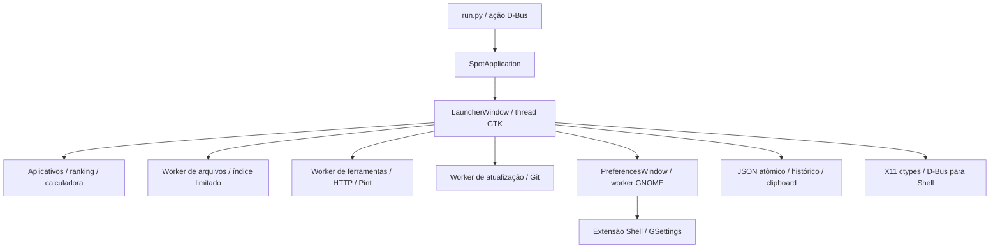

# Auditoria técnica — Spot Launcher 1.8.0

**Registro histórico da versão auditada.** As correções posteriores estão em [correcoes.md](correcoes.md).

Data: 8 de novembro de 2026. Base: `3c7b8a6dbd2ebce6b3e47bc5e3df90383cee8810`.

## Resultado e prioridades

**13 problemas confirmados**, incluindo perda condicional de arquivos locais, vazamento de memória das preferências e persistência de conteúdo marcado como segredo. Os 148 testes existentes passam; os casos abaixo mostram lacunas dessa cobertura. Nenhum arquivo do produto foi corrigido nesta auditoria.

| ID | Prioridade | Problema | Evidência principal |
|---|---|---|---|
| AUD-01 | P1 — alta | Atualização sobrescreve arquivos locais ignorados pelo Git | Repositórios descartáveis; conteúdo local efetivamente substituído |
| AUD-02 | P1 — alta | Fechar preferências retém a janela e seus widgets | 100 objetos vivos; aproximadamente 211 MiB adicionais de PSS |
| AUD-03 | P2 — média | Clipboard ignora marcador de segredo e persiste o texto | Provider GDK real, com marcador; conteúdo continua no cache após limpar clipboard |
| AUD-04 | P2 — média | Configuração sem validação quebra busca e Super | Tipos inválidos na paginação; `null` reproduzido no GNOME 51.1 |
| AUD-05 | P2 — média | Resultados assíncronos trocam a seleção do teclado | Alpha selecionado passa a Beta quando a busca de arquivos termina |
| AUD-06 | P2 — média | Conversão altera símbolos SI sensíveis à caixa | `1 Mm em m` copia `0.001`, em vez de `1000000` |
| AUD-07 | P2 — média | Cópia de conversão monetária perde valores pequenos | Exibe `0.000014 BTC`, copia `0.00` |
| AUD-08 | P2 — média | Persistência síncrona bloqueia a thread GTK | `fsync` com atraso controlado de 150 ms adia o heartbeat por aproximadamente 150 ms |
| AUD-09 | P2 — média | Falha de abertura oculta o launcher sem aviso | Retorno `False` de abertura seguido de `hide_launcher()` |
| AUD-10 | P2 — média | Aplicativos de terminal perdem `Path` do arquivo desktop | Processo real inicia no diretório do launcher |
| AUD-11 | P2 — média | Compatibilidade com Blur altera configuração externa sem preservar sua origem | Entrada preexistente da whitelist é removida |
| AUD-12 | P2 — média | Dicionário obsoleto continua fazendo requisições e atrasa a tarefa atual | Três requisições adicionais após invalidação; tarefa seguinte espera aproximadamente 240 ms no ensaio |
| AUD-13 | P3 — baixa | Conversão monetária permite resultado não finito | Entrada finita de `1e308` USD resulta em `inf` BRL |

P1 indica risco de perda de dados ou crescimento persistente significativo de recursos. P2 indica exposição local de informação, resultado incorreto ou falha funcional com condições reproduzíveis. P3 corresponde ao caso numérico extremo. Nenhum problema foi classificado como crítico.

A confiança nos comportamentos reproduzidos é alta. A versão afetada comprovada é **1.8.0 neste commit**; versões anteriores e outras combinações de bibliotecas não foram ensaiadas. As condições de cada reprodução limitam sua abrangência.

## Estrutura, ambiente e método

O ponto de entrada configura GTK e instancia `SpotApplication`. A aplicação mantém a instância residente e expõe a ação D-Bus `toggle`. `LauncherWindow` coordena resultados, ativação, preferências, clipboard e três workers. Busca de aplicativos e cálculos locais executam na thread GTK; arquivos e ferramentas possuem workers distintos. Preferências criam outro worker para instalar a integração GNOME.



Os defeitos de arquitetura identificados têm consequências concretas: ciclo de vida de preferências com referências nativas retidas, estado de seleção descartado na recomposição da lista, configuração compartilhada com validação diferente entre Python e JavaScript, I/O síncrono em callbacks e uma fila de ferramentas ocupada por trabalho já invalidado. O tamanho dos módulos, isoladamente, não foi considerado defeito.

Ambiente medido: Fedora 45, GNOME Shell/Mutter 51.1, Python 3.15.0, GTK 4.24.1, libadwaita 1.10.0, PyGObject 3.58.1, RapidFuzz 3.14.5, Pint 0.26.2. Inventário e consulta de dependências: [dependencias.json](resultados-1.8.0/dependencias.json).

Os ensaios gráficos usam GNOME headless, diretórios HOME/XDG temporários, clipboard próprio e D-Bus privado. O renderer GTK é Cairo; o ambiente do compositor define `LIBGL_ALWAYS_SOFTWARE=1`. Não houve execução de suspensão, logout, reinício ou desligamento. Não foram coletados clipboard ou histórico pessoais. Dependências do user-site são preservadas no `PYTHONPATH` dos reprodutores; os dados da aplicação continuam isolados.

`check_update` é substituído no coletor gráfico para impedir fetch ou merge na instalação auditada. Os testes do atualizador operam exclusivamente em repositórios temporários. Falhas de HTTP são simuladas com dados sintéticos; não houve disparo de milhares de consultas aos serviços externos.

### Evidências e interpretação dos testes

- **148 testes existentes aprovados** na exploração inicial. Na [reexecução isolada](resultados-1.8.0/suite-existente.log), 147 passaram e um teste de layout foi pulado por ausência de display; os cenários gráficos específicos foram executados no compositor headless.
- **17 reproduções adicionais aprovadas**: [reproducoes.json](resultados-1.8.0/reproducoes.json) e [log](resultados-1.8.0/reproducoes.log). Os testes de defeitos esperam o comportamento defeituoso desta versão: aprovação significa reprodução confirmada, não correção.
- Interface GTK real: [interface-functional-wayland.json](resultados-1.8.0/interface-functional-wayland.json). Captura inspecionada: [PNG em escala 200%](resultados-1.8.0/interface-functional-wayland.png).
- Extensão no compositor real: [gnome-51.json](resultados-1.8.0/gnome-51.json) e [log do Shell](resultados-1.8.0/gnome-shell.log). O teste em `gjs` com objetos simulados da suíte original é evidência lógica complementar.

## Problemas confirmados e correções mínimas sugeridas

### AUD-01 — Atualização pode destruir conteúdo local ignorado

**Local:** `src/updater.py:31`, `install_update()`.

**Esperado:** a atualização preservar conteúdo local que não integra o commit instalado. **Observado:** a checagem de limpeza desconsidera arquivos ignorados, e `git merge --ff-only` pode sobrescrevê-los quando o commit remoto passa a rastrear o mesmo caminho.

**Reprodução:** `test_updater_divergence_untracked_and_ignored_data_loss`. Criar arquivo local ignorado, adicionar remotamente um arquivo rastreado no mesmo caminho, verificar e instalar a atualização. O instalador retorna sucesso e o conteúdo local é substituído. Colisões com arquivos não ignorados e histórico divergente foram recusadas corretamente.

**Impacto/condições:** perda de dados dentro do checkout quando o novo commit introduz um caminho previamente ignorado na instalação. O ensaio não demonstra perda em qualquer atualização; a colisão é necessária.

**Correção mínima:** impedir sobrescrita de ignorados no merge, além das proteções atuais, e apresentar a falha. **Regressão:** o mesmo fixture deve preservar o conteúdo local e recusar a instalação; manter os testes de avanço normal, alterações rastreadas e divergência.

### AUD-02 — Janelas de preferências fechadas continuam retidas

**Locais:** `src/preferences.py:134`; `src/window.py:1175` e `:1182`.

**Esperado:** reabrir e fechar preferências não aumentar continuamente a memória residente da aplicação. **Observado:** cada abertura cria uma nova instância; fechar remove a referência do launcher, mas callbacks ligados aos widgets continuam referenciando a instância Python.

**Reprodução:** modo `functional` do coletor gráfico. Após fechamento e `gc.collect()`, 50/50 e depois 100/100 referências fracas continuam resolvendo os objetos. Há apenas uma janela na lista de toplevels: a ausência de janelas visíveis não demonstra liberação. `gc.get_referrers()` identifica métodos `_on_*` da própria `PreferencesWindow` e uma célula de closure. O crescimento foi observado em execuções independentes.

**Impacto/condições:** aproximadamente 2 MiB adicionais por abertura nesta pilha GTK, acumulados enquanto o daemon permanecer ativo. Os valores exatos dependem das bibliotecas e fontes.

**Correção mínima:** reutilizar uma única janela de preferências ou desfazer efetivamente as referências e handlers ao destruí-la. Se houver reutilização, o worker GNOME precisa continuar utilizável e ser encerrado no shutdown da aplicação. **Regressão:** 100 aberturas/fechamentos com objetos antigos liberados ou uma única instância reutilizada, memória estabilizada e integrações funcionando após reabrir.

### AUD-03 — Texto marcado como segredo é persistido no clipboard

**Locais:** `src/window.py:1245`–`:1255`; `src/tools.py:518`.

**Esperado:** respeitar o marcador de conteúdo sensível oferecido pelo produtor antes de registrar texto em histórico. **Observado:** o callback lê somente texto e o grava no JSON, ignorando os formatos disponíveis. Limpar posteriormente o clipboard deixa o texto no histórico.

**Reprodução:** no modo `functional`, um provider GDK real oferece texto sintético e `x-kde-passwordManagerHint: secret`. Os campos `secret_hint_offered`, `secret_persisted` e `secret_persisted_after_clipboard_clear` são verdadeiros. Nenhuma senha real foi utilizada.

**Impacto/condições:** retenção local de segredos marcados por produtores compatíveis. O arquivo é privado (`0600`), mas a persistência amplia a duração da exposição a processos e coleta de dados da própria conta. O README já alerta sobre conteúdo sensível; esse aviso não implementa o tratamento do marcador. A convenção é emitida pelo [KeePassXC](https://raw.githubusercontent.com/keepassxreboot/keepassxc/develop/src/gui/Clipboard.cpp) e documentada na implementação de [wl-clipboard](https://github.com/bugaevc/wl-clipboard/commit/e3c1b21ddd0885fba909602cf21e9f4f35862dea).

**Correção mínima:** ignorar ofertas com o marcador sensível antes da leitura/persistência, mantendo a invalidação de respostas antigas. **Regressão:** oferta marcada não entra no histórico; cópia comum continua funcionando; limpeza não ressuscita conteúdo marcado.

### AUD-04 — Configurações inválidas quebram busca e integração GNOME

**Locais:** `src/preferences.py:83`; `src/window.py:957`; `data/gnome-extension/extension.js:9` e `:61`.

**Esperado:** configuração inválida utilizar valores seguros. **Observado:** `max_results` como string, `null`, lista, fração ou inteiro negativo chega à paginação e produz `TypeError`/`ValueError`. Na extensão, JSON `null` é aceito pelo parser e retorna como configuração; o handler de Super tenta acessar `super_launcher` e falha, após o bloqueio do handler original.

**Reprodução:** `test_config_wrong_types_reach_pagination` e teste real do Shell com configuração `null`. O log contém o `TypeError`; Super volta a abrir o panorama ao restaurar `{}`. JSON truncado e escala inválida possuem fallback e passaram nos testes.

**Impacto/condições:** busca inutilizável e perda do comportamento de Super após configuração corrompida ou editada com tipos incorretos. Não é evidência de execução remota.

**Correção mínima:** validar objeto, tipos e faixas nos dois pontos de leitura, reaproveitando os defaults existentes. **Regressão:** testar tipos inválidos por campo, recuperação da busca e Super funcional com arquivo ausente, truncado e `null`.

### AUD-05 — Busca de arquivos descarta a seleção do usuário

**Locais:** `src/window.py:865`, `:877` e seleção ao final de `_render_matches()`.

**Esperado:** a chegada de arquivos preservar o aplicativo selecionado quando ele continua na lista. **Observado:** o primeiro render permite selecionar outro aplicativo; o callback de arquivos limpa e reconstrói os resultados, selecionando o primeiro novamente.

**Reprodução:** no modo `functional`, dois aplicativos sintéticos e uma busca de arquivos atrasada em 350 ms. Após seta para baixo, a seleção é `audit-Alpha.desktop`; ao terminar a busca, passa a `audit-Beta.desktop`, sem nova ação do usuário.

**Impacto:** Enter pode executar um resultado diferente do escolhido. **Correção mínima:** preservar seleção por identidade durante atualização da mesma consulta. **Regressão:** selecionar o segundo aplicativo, entregar arquivos, confirmar que Enter permanece associado a ele; definir fallback quando o item realmente desaparecer.

### AUD-06 — Normalização muda o significado dos prefixos SI

**Local:** `src/tools.py:470`, `convert_units()`.

**Esperado:** preservar a caixa dos símbolos reconhecidos pelo Pint. **Observado:** a consulta inteira é normalizada para minúsculas antes de extrair as unidades: `Mm` vira `mm`.

**Reprodução:** `test_unit_prefix_case_changes_physical_value`. O próprio registro Pint retorna `1000000 m` para `1 Mm`; o launcher interpreta milímetro e copia `0.001`. Diferença de fator `10^9`.

**Impacto:** resultados científicos incorretos para símbolos sensíveis à caixa. **Correção mínima:** reconhecer conectivos e aliases sem alterar símbolos originais enviados ao Pint. **Regressão:** distinguir `Mm`/`mm`, preservar os aliases de temperatura e impedir busca monetária indevida para unidades válidas.

### AUD-07 — Valor monetário exibido diverge do copiado

**Local:** `src/tools.py:406` e `:417`.

**Reprodução:** `test_currency_copy_loses_small_values_and_overflows`, com cotações sintéticas e recentes: `1 USD = 0.000014 BTC`. O título mantém seis casas; `copy` força duas e retorna `0.00`.

**Impacto:** o valor levado para outro aplicativo perde significado, apesar do resultado visível correto. **Correção mínima:** usar precisão coerente entre apresentação e cópia, preservando o separador esperado no valor copiado. **Regressão:** valores pequenos positivos e negativos, moedas comuns e conferência do texto efetivamente copiado.

### AUD-08 — I/O de disco executa dentro de callbacks GTK

**Locais:** `src/window.py:1250`; `src/tools.py:518`; `src/history.py:59`; callbacks de preferências e `src/storage.py:8`.

**Esperado:** disco lento não bloquear digitação e eventos gráficos. **Observado:** gravação do clipboard, gravação após lançar aplicativo e alterações de preferências chegam sincronamente a JSON/`fsync`. A leitura assíncrona do clipboard não torna sua persistência assíncrona.

**Reprodução:** `test_clipboard_io_blocks_glib_main_thread` injeta 150 ms no `fsync` real. O heartbeat GLib de 10 ms só executa após aproximadamente 150 ms, na mesma thread. `test_history_io_is_synchronous_on_caller` comprova o outro caminho. Clipboard sintético de 2 MiB também foi aceito e persistido integralmente.

**Impacto/condições:** travamentos perceptíveis com disco lento, pressão de I/O ou conteúdos grandes; o atraso de 150 ms é uma condição controlada, não uma medição do disco em uso normal.

**Correção mínima:** retirar leitura/gravação lenta dos callbacks, preservando ordem, tratamento de erro e última persistência no shutdown. Manter o helper atômico. **Regressão:** heartbeat continua executando com disco atrasado; histórico não perde entradas nem regride para snapshots antigos.

### AUD-09 — Erros de abertura ficam invisíveis ao usuário

**Locais:** `src/window.py:1118`–`:1134`; `src/files.py:177`; `src/indexer.py:122`.

**Reprodução:** `test_file_failure_hides_launcher`: abertura retorna `False` e a janela é ocultada mesmo assim. O ramo de aplicativos também oculta após falha; só registra uso em caso de sucesso, corretamente.

**Impacto:** falhas de handler, executável ou arquivo desaparecido parecem uma ativação bem-sucedida e apagam o contexto da busca. **Correção mínima:** manter a janela e informar a falha quando o lançamento retornar erro. **Regressão:** arquivos e aplicativos com sucesso e falha; preservar consulta e evitar histórico de lançamento fracassado.

### AUD-10 — Lançamento em terminal ignora diretório da entrada desktop

**Local:** `src/indexer.py:122`, ramo `entry.is_terminal`.

**Reprodução:** `test_terminal_desktop_path_is_lost` cria um `.desktop` real com `Path` apontando para diretório temporário e um terminal controlado que registra seu cwd. O processo inicia no diretório do launcher. O ramo remonta uma nova `AppInfo` a partir de `Exec`, descartando metadados da entrada original.

**Impacto/condições:** aplicativos de terminal que dependem de `Path` iniciam no local errado. **Correção mínima:** preservar o diretório de trabalho e os argumentos da entrada ao usar o terminal compatível. **Regressão:** diretório solicitado, caminhos com espaços, aspas, field codes e ausência de terminal; não executar shell para entradas comuns.

### AUD-11 — Blur altera preferências externas sem preservar sua origem

**Local:** `src/preferences.py:111`–`:131`; documentação “Blur my Shell” no README.

**Reprodução:** `test_blur_removes_preexisting_user_entry`: a whitelist já contém `SpotLauncher` antes do Spot alterá-la; desabilitar remove a entrada. O código também pode ativar/desativar o blur global. Isso diverge do contrato documentado de não alterar as preferências da extensão.

**Impacto/condições:** com o schema do Blur instalado, desabilitar compatibilidade pode apagar configuração manual anterior e afetar a configuração global de blur. A reprodução é lógica, com GSettings simulado; o efeito visual da extensão não foi validado.

**Correção mínima:** cumprir o contrato atual, restringindo a opção à apresentação do Spot e mantendo as instruções de configuração externa. **Regressão:** mudar a opção não modifica whitelist nem estado global preexistente; aparência local continua atualizando.

### AUD-12 — Consulta descartada continua ocupando o worker de ferramentas

**Locais:** `src/worker.py:37`; `src/dictionary.py:63`–`:93`.

**Esperado:** invalidar uma consulta impedir trabalho adicional desnecessário e permitir atendimento da consulta atual. **Observado:** o resultado antigo é corretamente descartado, mas a tarefa continua tentando minúsculas, busca de sugestão e nova definição. Tudo compartilha o worker com conversões locais e outras ferramentas.

**Reprodução:** `test_obsolete_dictionary_keeps_fetching_before_latest_task`, com quatro respostas de 60 ms: três requisições começam depois da invalidação; a tarefa seguinte espera aproximadamente 240 ms. Em produção cada chamada possui timeout de cinco segundos; o ensaio não mede latência real do Wiktionary nem garante um deadline total de 20 segundos.

**Impacto/condições:** rede lenta em uma consulta anterior adia resultados atuais, inclusive ferramentas locais. GTK permanece responsivo; o bloqueio é da fila de ferramentas.

**Correção mínima:** verificar validade entre etapas da consulta, impedindo novos fetches obsoletos; manter o descarte na entrega. **Regressão:** invalidar durante o primeiro fetch não inicia os seguintes; a última consulta recebe atendimento após a chamada já iniciada terminar.

### AUD-13 — Resultado monetário pode ser infinito

**Local:** `src/tools.py:403`–`:417`.

**Reprodução:** no teste monetário, número decimal finito equivalente a `1e308`, convertido com taxa BRL `5`, produz título e cópia `inf`. Entrada e taxas são individualmente finitas; a multiplicação não é validada.

**Impacto/condições:** saída inválida para magnitude extrema, sem transação financeira envolvida. **Correção mínima:** rejeitar resultado não finito antes de formatar/copiar, como já fazem calculadora e conversão de unidades. **Regressão:** overflow, valores próximos ao limite e conversões normais.

## Medições e resultados negativos relevantes

### Interface e busca

O coletor chama a entrada real `run.main()`, usando after-paint para registrar primeiro frame e término do fade. A tabela abaixo mede **janela mapeada com opacidade 100%**. Inicialização inclui o disparo pelo processo pai e a criação do D-Bus privado; não é uma medição isolada do tempo de Python. O compositor já está ativo e o cache do SO não foi limpo.

| Backend | Cenário | Amostras | Mediana (ms) | p95 (ms) |
|---|---|---:|---:|---:|
| Wayland nativo | Processo novo → utilizável | 30 | 743.562 | 846.342 |
| Wayland nativo | Primeira abertura do daemon pronto | 30 | 114.696 | 119.226 |
| Wayland nativo | Reabertura | 30 | 112.273 | 125.616 |
| XWayland forçado | Processo novo → utilizável | 30 | 529.837 | 981.547 |
| XWayland forçado | Primeira abertura do daemon pronto | 30 | 123.986 | 129.726 |
| XWayland forçado | Reabertura | 30 | 114.871 | 129.214 |
| Automático, com DISPLAY | Processo novo → utilizável | 30 | 617.614 | 972.029 |
| Automático, com DISPLAY | Primeira abertura do daemon pronto | 30 | 124.898 | 158.017 |
| Automático, com DISPLAY | Reabertura | 30 | 114.567 | 116.112 |

No modo automático, o backend observado é `GdkX11Display`, mesmo sobre o compositor Wayland. Isso confirma a preferência configurada no ponto de entrada, não uma incompatibilidade por si só. Os tempos de reabertura incluem animação configurada de 120 ms, com amostragem por frames. Não permitem concluir superioridade de um backend em hardware real.

Dados completos: [interface-latency.json](resultados-1.8.0/interface-latency.json). O coletor aguarda ocultação efetiva antes da próxima abertura e mantém o panorama fechado. Ensaios iniciais que só observavam o primeiro frame ou dependiam de um intervalo fixo de fechamento foram substituídos, pois não mediam o critério acima de forma consistente. O cenário automático foi reensaiado após aplicar a escolha de backend antes dos imports GTK da própria instrumentação; a verificação final conferiu o backend efetivo das 270 amostras. A tabela reúne duas passagens, sem comparação controlada entre backends.

O [benchmark existente, executado novamente](resultados-1.8.0/benchmark.json), encontrou 76 aplicativos: buscas com p95 de aproximadamente 0,84–1,19 ms e reload com p95 de 18,62 ms. Com 10 mil arquivos sintéticos, o p95 foi 16,49–24,72 ms para as consultas medidas. Esse benchmark coincidiu parcialmente com o trabalho de stress e não constitui comparação controlada com o relatório histórico. O caso sintético de 50 mil entradas excede o limite de produção de 10 mil e não fundamenta um problema de desempenho em uso suportado.

### Memória, CPU e estabilidade

| Etapa da reprodução de preferências | Objetos fechados ainda vivos | PSS (MiB) | Private_Dirty (MiB) |
|---|---:|---:|---:|
| Antes de abrir preferências | 0 | 51,6 | 35,4 |
| Após fechar 50 vezes e coletar lixo | 50 | 159,1 | 143,8 |
| Após fechar 100 vezes e coletar lixo | 100 | 263,0 | 252,0 |

Os dados são os checkpoints anteriores à captura de imagem, que cria recursos adicionais de renderização. Não foi inferido vazamento apenas de um pico de RSS: há crescimento repetido, objetos retidos e referências identificadas.

O ensaio longo completou 1.000 ciclos de mostrar/ocultar, 50 ciclos de preferências e 1.000 consultas distintas de geocodificação e tentativas de clima simuladas. O índice sintético possuía 10 mil entradas. Nos ciclos da janela principal, descritores permaneceram em 13; não apareceu crescimento semelhante ao das preferências.

**A observação de ociosidade foi interrompida após 1.890,68 s (31,51 minutos), antes da meta de 60 minutos.** Aplicação e compositor do ensaio foram encerrados pela interrupção da sessão de execução. Os dados parciais estão preservados em [interface-stress-wayland.json](resultados-1.8.0/interface-stress-wayland.json); este cenário fica **bloqueado/incompleto**, sem aprovação da duração planejada.

Nesse intervalo, o CPU acumulado aumentou 2,2596 s, aproximadamente 0,12% de um núcleo, incluindo o próprio coletor, GC e serialização periódica. O crescimento de cerca de 61 KiB rastreado por Python inclui a lista crescente de amostras do coletor. Não foi identificado busy-loop nesse período.

RSS caiu de aproximadamente 113 para 59 MiB durante a ociosidade; isso não comprova liberação da memória das preferências. A [coleta suplementar de swap](resultados-1.8.0/idle-swap-suplementar.json) registrou aproximadamente 119 MiB em swap, estáveis no trecho observado. Ela começou depois dos ciclos; não há série de swap desde o início do ensaio.

### Proteções que passaram

- Escrita JSON preserva o arquivo anterior quando `os.replace` falha, remove temporários e cria arquivo `0600`; substituição de symlink final não sobrescreveu seu alvo.
- Índice real com 10.020 arquivos respeitou 10 mil entradas, removeu caminho apagado após refresh e tratou EACCES simulado. A suíte original exercita exclusões e ciclos de symlinks.
- Workers descartam respostas antigas, inclusive já despachadas; fechar impede entrega, e a tarefa ativa termina antes da saída da thread. A limitação de AUD-12 se refere às novas etapas de I/O da tarefa antiga.
- Cotações antigas sobrevivem à falha de rede e recebem indicação de desatualização; unidades e calculadora possuem validações já cobertas pela suíte original.
- Calculadora usa AST limitado, sem `eval`; limites de expressão, nós, profundidade, potência e resultado estão presentes e possuem testes.
- Comandos `>` exigem ativação; comandos de sistema usam argumentos separados e confirmações para reinício, desligamento e logout nos testes. Não foi demonstrado vetor de execução arbitrária por uma busca comum.
- Escalas de 50% a 200% produziram larguras esperadas na interface real. Role acessível da pesquisa é `search-box`; validação com leitor de tela permanece pendente.
- Datas regionais funcionaram com processos reais em pt_BR, en_US, en_GB e fr_FR: [regionais.json](resultados-1.8.0/regionais.json).

## Cobertura GNOME, hipóteses e reprodução

### Matriz de compatibilidade

| Versão | Aplicativo Wayland / XWayland | Extensão real | Sessão Xorg |
|---|---|---|---|
| 45 | Bloqueado: ambiente não disponível | Bloqueado | Bloqueado |
| 46 | Bloqueado: ambiente não disponível | Bloqueado | Bloqueado |
| 47 | Bloqueado: ambiente não disponível | Bloqueado | Bloqueado |
| 48 | Bloqueado: ambiente não disponível | Bloqueado | Bloqueado |
| 49 | Bloqueado: ambiente não disponível | Bloqueado | Bloqueado, dependendo da distribuição |
| 50 | Bloqueado: ambiente não disponível | Bloqueado | Não aplicável ao upstream |
| 51.1 | Executados em compositor headless; falhas discriminadas acima | Executada; configuração `null` falhou | Não aplicável ao upstream |

A sessão libvirt do usuário não tinha VMs disponíveis; o diretório de imagens do sistema não era acessível. Não foram baixadas imagens nem instaladas versões paralelas do desktop. Não se atribui compatibilidade às versões 45–50 com base em metadata, testes simulados ou leitura de guias. O [guia oficial do GNOME 50](https://gjs.guide/extensions/upgrading/gnome-shell-50.html) registra a retirada do suporte a sessão X11; aplicativos X11 via XWayland são um cenário diferente.

| Cenário | Estado e limite da evidência |
|---|---|
| Importar, ativar e desativar extensão 51.1 | Executado no Shell real; ver contagem e recursos em `gnome-51.json` |
| Outra extensão alterando `overview.show` | Aprovado com fixture no Shell real, incluindo rebase ao desativar hooks nas duas ordens; não certifica todas as extensões de terceiros |
| Super e panorama | Handler `overlay-key` emitido no compositor real; restauração verificada após disable; `null` falhou |
| Tecla Super física e atalhos reservados | Bloqueado: não exercitados por entrada física no desktop de trabalho |
| D-Bus com launcher ausente | Executado; Shell sobreviveu à ativação sem serviço disponível |
| Posicionamento Wayland em um monitor virtual | Executado; frame 580×92 em (350,269), correspondente ao monitor 1280×900 |
| Esc, setas, Alt, foco e diálogos | Suíte original e navegação por método real GTK; interação física completa não validada |
| Instalação/atualização da extensão e necessidade de novo login | Caminhos simulados cobertos; ciclo completo de logout/login bloqueado sem sessão descartável completa |
| Autostart e reinício após reboot | Geração e quoting testados; login/reboot real bloqueado |
| Multi-monitor, coordenadas negativas, escalas mistas/fracionárias e hotplug | Lógica parcialmente simulada; validação física bloqueada por ausência da configuração correspondente |
| Blur my Shell e Caffeine | Metadata instalada observada (77 e 61); leitura de código e testes lógicos; blur visual e inibição real bloqueados sem ensaio de sessão completo |
| Acessibilidade com leitor de tela | Bloqueado: serviço a11y recusou execução na sessão isolada; não é atribuído ao produto |
| Suspensão, desligamento e logout reais | Bloqueado: execução restrita a VM/sessão descartável completa, indisponível; comandos e confirmação simulados |
| Sessões encerradas durante I/O e respostas fora de ordem | Worker testado; encerramento físico da sessão durante atualização/login permanece bloqueado |

### Hipóteses e riscos ainda sem impacto excessivo comprovado

- **Caches sem limite explícito:** 1.000 consultas deixaram 1.000 geocodificações e 1.000 tentativas de clima. O fixture de geocodificação persistiu cerca de 80 KiB. Isso comprova crescimento, mas não consumo excessivo em uso comum; não foi classificado como vazamento. TTL de clima controla validade, não remoção de chaves.
- **Tamanho de respostas e clipboard:** geocodificação, clima e cotações usam `read()` sem teto explícito; tradução e dicionário limitam leitura a 2.000.000 bytes. Clipboard limita quantidade a 15, mas aceita 2 MiB por texto no ensaio. Robustez com produtores gigantes ou transporte que progride indefinidamente exige teste adicional; não se declarou DoS remoto explorável apenas dessas leituras.
- **Memória do Shell:** 200 ciclos reais, com GC e assentamento, terminaram com PSS abaixo do checkpoint inicial e zero objetos antigos de exportação D-Bus vivos. Não houve crescimento persistente nesse cenário. O vazamento confirmado é o de preferências Python/GTK, com objetos identificados; não foi executado ensaio prolongado da extensão em sessão física.
- **Dependências e versões mínimas:** OSV não retornou advisories para as oito versões Python consultadas. [Pint](https://github.com/hgrecco/pint/security/advisories) e [RapidFuzz](https://github.com/rapidfuzz/RapidFuzz/security/advisories) não apresentaram advisories publicados na consulta aos mantenedores. `dnf5 --cacheonly advisory list --available --security` terminou com sucesso sem listar advisories disponíveis nos metadados locais; inventário nativo e saída estão em `dependencias.json`. A página de política do PyGObject não pôde ser acessada pela ferramenta. A verificação não é exaustiva quanto a CVEs nativos e backports Fedora; o resultado não é selo de segurança. As versões mínimas anunciadas não foram executadas.
- `Gio.DesktopAppInfo` emitiu depreciação, mas funcionou na versão ensaiada. Isso fica como acompanhamento de compatibilidade; não fundamenta migração cosmética ou incompatibilidade já confirmada.

O ciclo de vida da extensão foi comparado com os [critérios oficiais de limpeza](https://gjs.guide/extensions/review-guidelines/review-guidelines.html) e os guias de migração [45](https://gjs.guide/extensions/upgrading/gnome-shell-45.html), [46](https://gjs.guide/extensions/upgrading/gnome-shell-46.html), [47](https://gjs.guide/extensions/upgrading/gnome-shell-47.html), [48](https://gjs.guide/extensions/upgrading/gnome-shell-48.html), [49](https://gjs.guide/extensions/upgrading/gnome-shell-49.html), [50](https://gjs.guide/extensions/upgrading/gnome-shell-50.html) e [51](https://gjs.guide/extensions/upgrading/gnome-shell-51.html). Leitura de documentação não substitui execução das versões.

### Como reproduzir

Na raiz do checkout, com as dependências já instaladas:

```bash
python3 -B -m unittest discover -s tests -v
python3 -B docs/auditoria/reproducoes.py
python3 -B docs/auditoria/sessao-isolada.py functional docs/auditoria/resultados-novos
python3 -B docs/auditoria/sessao-isolada.py gnome docs/auditoria/resultados-novos
python3 -B docs/auditoria/sessao-isolada.py latency docs/auditoria/resultados-novos
python3 -B docs/auditoria/sessao-isolada.py stress docs/auditoria/resultados-novos
```

O último comando precisa de aproximadamente uma hora de ociosidade depois dos ciclos. O runner exige `gnome-shell` e `dbus-run-session`, cria seu próprio ambiente, fecha o compositor e desmonta os mounts FUSE privados ao sair. Não execute `medir-interface.py` diretamente na sessão pessoal. Os comandos gráficos consomem recursos e não representam certificação de desempenho em hardware físico.

### Ordem recomendada das correções posteriores

1. Preservar arquivos ignorados na atualização, corrigir ciclo de vida de preferências e respeitar ofertas sensíveis do clipboard.
2. Corrigir símbolos SI, precisão de cópia e validação do resultado monetário.
3. Validar configuração em Python/JavaScript e preservar seleção durante atualização assíncrona.
4. Tratar falhas de lançamento, preservar `Path`, cumprir contrato do Blur e reduzir trabalho obsoleto/I/O na thread GTK.

As correções acima não foram aplicadas. Permanecem pendentes a duração contínua de 60 minutos e os ambientes/hardware assinalados como bloqueados; os dados existentes sustentam os achados confirmados, não a compatibilidade integral da faixa GNOME declarada.
